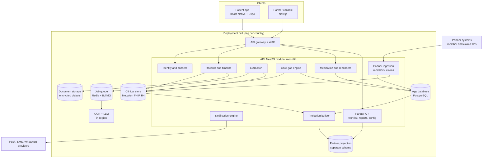
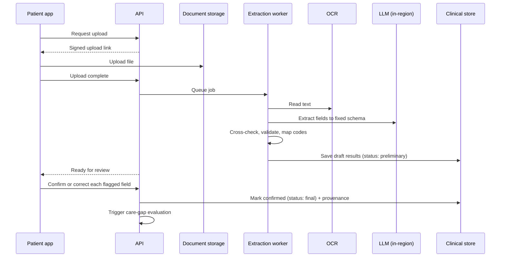
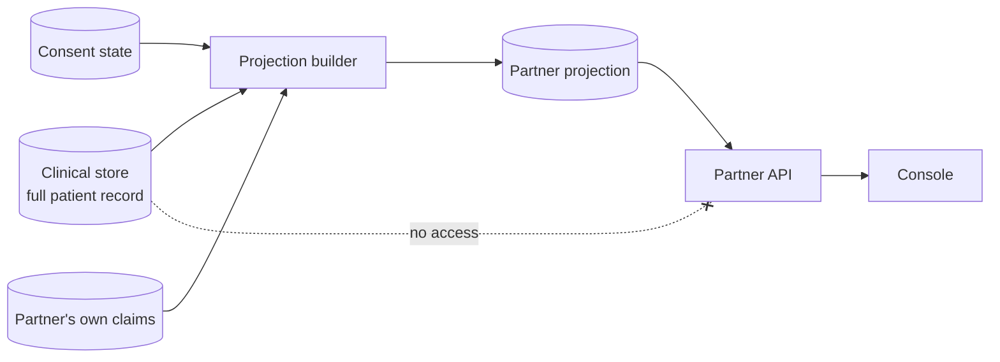

# Deliverable 4: System Architecture

_Version 1, 2026-11-19. Implements [05-prd-mvp.md](05-prd-mvp.md) (releases R1 and R2)._
_Cloud service availability by region changes often and was not checked against current vendor pages. Every **[Verify]** must be confirmed before the corresponding piece is built._

## 1. Principles

1. **One codebase, one deployment cell per country.** A cell is a complete, independent copy of the system in an in-country cloud region. No health data crosses cells.
2. **The patient owns the record; the partner gets a projection.** Partner-facing code can only read a separate, consent-filtered data set. It has no path to the clinical store.
3. **Every clinical value carries its source.** Nothing is stored without provenance and a verification status.
4. **No generated text reaches a patient.** The LLM extracts; rules and approved templates explain.
5. **Boring technology, one language.** TypeScript end to end, PostgreSQL for nearly everything, managed services where they exist in-region.
6. **Swappable edges.** Identity, messaging, OCR, LLM, drug list and exchange connectors sit behind interfaces because each differs by country.

## 2. Components



| Component | Responsibility | Release |
|---|---|---|
| **Patient app** | Sign-up, upload, review, timeline, charts, reminders. Medication reminders are scheduled on the device so they fire offline. | R1 |
| **Partner console** | Member import, worklist, dashboard, reports, configuration. | R2 |
| **Identity and consent** | Patient OTP login, console login with MFA, consent records, tenant membership. | R1 / R2 |
| **Records and timeline** | Reads and writes clinical data through a `ClinicalRepository` interface; serves timeline and trends. | R1 |
| **Extraction** | Turns an uploaded document into reviewed, coded observations (section 4). | R1 |
| **Care-gap engine** | Evaluates versioned rules per patient when data changes and nightly; writes gap state. | R1 |
| **Medication and reminders** | Medication list, schedules, dose logs, refill prediction. | R1 |
| **Notification engine** | Decides what to send, on which channel, under rate limits and quiet hours. | R1 / R2 |
| **Partner ingestion** | Validates and loads member and claims files; matches members; computes PDC. | R2 |
| **Projection builder** | The only writer of partner-visible data; applies consent on every write (section 5). | R2 |
| **Partner API** | Serves the console from the projection only. | R2 |

**Modular monolith rule:** modules call each other through exported service interfaces only, never through each other's tables. That keeps a later split into services cheap.

## 3. Data stores

| Store | Technology | Holds | Notes |
|---|---|---|---|
| Clinical store | Medplum (self-hosted, FHIR R4) on its own PostgreSQL database | All patient health data as FHIR resources, with version history | Accessed only by the API through `ClinicalRepository`. **[Verify]** licence terms and memory footprint; fallback is FHIR JSON in PostgreSQL behind the same interface. |
| App database | PostgreSQL | Users, tenants, memberships, consent state, medication schedules, gap state, notification log, outreach log, audit log, job state | Row-level security on `tenant_id` for tenant-owned tables. |
| Partner projection | Separate PostgreSQL schema with its own database role | Per-member gap status, PDC band, activation state, aggregates | Console role can read this schema and nothing else. |
| Document storage | Object storage with server-side encryption | Original uploads and generated PDFs | Private; accessed with short-lived signed links; malware-scanned on upload. |
| Queue | Redis + BullMQ | Extraction jobs, notification jobs, projection jobs | Redis is already required by Medplum. |
| Analytics | `analytics` schema in PostgreSQL | Product events with no health values | Move to a warehouse only when query load requires it. |

## 4. Extraction pipeline



| Step | What happens | Safety control |
|---|---|---|
| 1. Intake | File type and size check, malware scan, page split, image clean-up | Reject anything that isn't an image or PDF |
| 2. Two independent reads | OCR produces raw text; a vision-capable LLM produces structured fields against a fixed JSON schema | The LLM's output is parsed and validated; free text is discarded |
| 3. Cross-check | Every extracted number must appear in the OCR text | Mismatch → low confidence, forced manual confirmation |
| 4. Validation | Plausible range per test, unit allowed for that test, date not in the future, reference range consistent with unit | Failure → field blocked until corrected |
| 5. Coding | Test name matched to LOINC through a curated synonym table; unit converted using UCUM | Unmatched names are kept as text and queued for our review; the LLM may suggest a code but never assigns one |
| 6. Patient review | Patient confirms; flagged fields one by one | Name mismatch with profile prompts "Is this your report?" |
| 7. Store | DocumentReference, DiagnosticReport, Observations and Provenance written together | Status stays "patient-uploaded, unverified" permanently |

**Model and OCR choice.** Use a managed vision LLM and managed OCR offered inside the cell's region. Candidates: Claude models on Amazon Bedrock, or Azure OpenAI, depending on what each region offers. **[Verify]** availability in the India and UAE regions, and that requests are not routed to another region. If no compliant managed option exists in a region, self-host an open-weight vision model and open-source OCR in that cell. The pipeline talks to both through `OcrProvider` and `ExtractionModel` interfaces, so this is a configuration choice per cell.

**Evaluation harness.** A labelled test set of real reports (target 200+, see PRD launch gate) runs in CI against every prompt or model change. No change ships if accuracy drops.

## 5. Multi-tenancy and the data firewall

**Tenancy model**
- A **tenant** is a partner organisation. R1 has one built-in tenant ("direct") for beta users.
- A **patient** is not owned by a tenant. A `membership` row links a patient to a tenant with the member ID and the consents given to that tenant. A patient who changes insurer keeps their record; the old membership is closed.
- Tenant-owned tables (members, claims staging, worklist, outreach log, configuration) carry `tenant_id` and are protected by PostgreSQL row-level security. The tenant is set from the authenticated session, never from a request parameter.
- Automated tests attempt cross-tenant reads on every partner endpoint and must fail.

**Firewall**



| Consent level | What the projection contains for that member |
|---|---|
| None, or withdrawn | Nothing beyond what the partner supplied itself (member ID, invitation status) |
| Gap status (default at enrolment) | Activated yes/no, open gap types and days overdue, PDC band from the partner's own claims, last-active week |
| Detailed sharing (opt-in) | The above plus lab values and dates for the diabetes marker set, each with its verification status |

- The Partner API's database role has no grants on the clinical store or app tables holding health data. The firewall is enforced by database permissions, not by application code alone.
- A consent change queues a projection rebuild for that member at high priority (target under 1 minute).
- Aggregates suppress any group smaller than 10.
- Data the partner sent us (its claims) is always visible to that partner; data from the patient or other sources is visible only by consent.

## 6. Security architecture

| Layer | Controls |
|---|---|
| **Network** | Databases, Redis and workers in private subnets; only the gateway is public; web application firewall and rate limiting; TLS 1.2+ everywhere. |
| **Identity: patients** | Phone OTP; short-lived access token with rotating refresh token stored in the device's secure storage; optional biometric app lock; new-device login notifies the user. |
| **Identity: console** | Email + password + mandatory TOTP MFA through a managed identity service or self-hosted Keycloak, whichever is available in-region **[Verify]**; SSO via OIDC later. |
| **Authorisation** | Role checks in the API plus row-level security in the database; patients can only reach their own compartment; console roles are admin, care manager, analyst. |
| **Encryption** | At rest with cloud-managed keys per cell; application-level encryption for national ID and phone number columns; signed links for documents expire in minutes. |
| **Secrets** | Cloud secret manager; nothing in the repository; secret scanning in CI. |
| **Audit** | Append-only audit table for every read or export of member-level data and every consent or configuration change; FHIR AuditEvent for clinical store access; shipped to write-once storage. |
| **Logging** | Structured logs with no health values, names or phone numbers; identifiers only. Enforced by a log-scrubbing middleware and a CI check. |
| **Development** | Branch protection and pull-request review on `main`; dependency and static analysis scans in CI; infrastructure as code; production data never leaves production; synthetic data generator for development and demos. |
| **Production access** | No standing access to production data; time-limited, logged break-glass access for incidents. |
| **Resilience** | Daily backups with point-in-time recovery, stored in-region; restore tested each quarter; uptime and error alerts. |
| **Mobile** | Minimal data cached on the device, encrypted; cache wiped on logout; app content hidden in the task switcher. |
| **Assurance** | Controls mapped to ISO 27001 Annex A from the start; external penetration test before R2. |

### Main threats

| Threat | Mitigation |
|---|---|
| Partner user reads records beyond consent | Projection-only access enforced by database role; automated firewall tests |
| Cross-tenant data leak | Row-level security; tenant from session; cross-tenant tests |
| Account takeover through SIM swap or OTP theft | Device binding, new-device alerts, re-verification with date of birth before showing records on a new device |
| Wrong person's report saved to a profile | Name check at review; patient confirmation; provenance retained for correction |
| Wrong extracted value drives a nudge or report | Cross-check, validation, permanent "unverified" status, evaluation harness |
| Prompt injection through text in an uploaded document | LLM output restricted to a fixed schema; no tools or actions available to the model; values must match OCR text |
| Health data leaves the country | Per-cell isolation; in-region OCR and LLM only; egress allow-list |
| Leaked credentials or dependency compromise | Secret manager, scanning, pinned dependencies, least-privilege service roles |

## 7. FHIR R4 data model

Identifiers use a namespaced `system` per source (tenant member ID, national ID type, our own ID). Codes keep both the standard code and the original text.

| Resource | Used for | Key fields |
|---|---|---|
| **Patient** | The person | `identifier[]` (our ID; member ID per tenant; national ID if given), `name`, `telecom`, `birthDate`, `gender`, `communication.language` |
| **Consent** | Each consent decision | `status`, `scope`, `category`, `patient`, `dateTime`, `policyRule` (policy version), `provision.type` (permit/deny), `provision.actor` (tenant), `provision.class` (data categories) |
| **DocumentReference** | Uploaded file | `status`, `type`, `subject`, `date`, `author` (patient), `content.attachment` (storage link, hash, content type) |
| **DiagnosticReport** | One lab report | `status`, `category` (LAB), `code`, `subject`, `effectiveDateTime`, `issued`, `performer` (lab), `result[]` → Observations, `presentedForm` → document. For a test known only from claims: `status = registered`, no results **[Assumption]** |
| **Observation** | One lab value or vital sign | `status` (`preliminary` until confirmed, then `final`), `category` (laboratory / vital-signs), `code` (LOINC coding + original `text`), `valueQuantity` (value, UCUM unit), `referenceRange`, `effectiveDateTime`, `performer`, `derivedFrom` → document, `meta.tag` (verification status), `method` for home readings |
| **Condition** | Diagnoses | `clinicalStatus`, `verificationStatus`, `code` (ICD-10 from claims; SNOMED CT where available), `subject`, `onsetDateTime` |
| **MedicationStatement** | Medicines the patient says they take | `status`, `medicationCodeableConcept` (local drug code + text), `subject`, `effectivePeriod`, `dosage` (dose, timing), `informationSource` (patient) |
| **MedicationRequest** | Prescriptions from a clinician source (later feeds) | `status`, `intent`, `medicationCodeableConcept`, `subject`, `authoredOn`, `requester`, `dosageInstruction`, `dispenseRequest` |
| **MedicationDispense** | Dispensing records from claims; basis for PDC | `status`, `medicationCodeableConcept`, `subject`, `whenHandedOver`, `quantity`, `daysSupply`, `performer` (pharmacy) |
| **MedicationAdministration** | Self-logged doses | `status` (completed / not-done), `medicationCodeableConcept`, `subject`, `effectiveDateTime`, `performer` (patient) |
| **Encounter** | Visits from claims | `status`, `class`, `type`, `subject`, `period`, `serviceProvider`, `reasonCode` |
| **Procedure** | Screenings such as eye and foot exams from claims or patient confirmation | `status`, `code`, `subject`, `performedDateTime`, `performer` |
| **Organization** | Labs, clinics, pharmacies, partners | `identifier`, `name`, `type` |
| **Provenance** | Source of every clinical resource | `target[]`, `recorded`, `agent` (who: patient, partner, system), `entity` (source document or file), `activity`, plus a source-type code: `patient-upload`, `patient-entered`, `payer-claims`, `provider-feed`, `hie` |
| **AuditEvent** | Access log for the clinical store | `type`, `action`, `recorded`, `agent`, `entity` |

**Kept outside FHIR, in the app database:** care-gap state, reminder schedules, notification log, worklist assignment, outreach log, raw claims staging. These are operational, change often, and are simpler as tables. Phase 2 resources (AllergyIntolerance, Appointment, Immunization) are added when their features are built.

**Terminology:** LOINC for labs, UCUM for units, ICD-10 for claims diagnoses, the local drug code set per market **[Verify]** code sets and licences for each market. Mappings live in a versioned `terminology` package with tests.

## 8. Region portability

| Varies by country | Interface | UAE | India |
|---|---|---|---|
| Hosting region | Infrastructure config | In-country region **[Verify]** | In-country region **[Verify]** |
| Patient identity | `IdentityProvider` | OTP, later UAE Pass | OTP, later ABHA |
| Drug list | `DrugCatalog` | Local regulator code lists | Local source **[Verify]** |
| Units and formats | `LocaleProfile` | mmol/L or mg/dL per lab, Arabic | mg/dL, Hindi |
| Messaging | `MessageChannel` | Local SMS sender rules **[Verify]** | Local SMS template registration rules **[Verify]** |
| OCR and LLM | `OcrProvider`, `ExtractionModel` | In-region option or self-hosted | In-region option |
| Record exchange | `RecordConnector` | Malaffi, NABIDH (later) | ABDM (later) |
| Consent and retention rules | `PolicyProfile` | Per legal advice | Per legal advice |

## 9. Deployment

| | R1 (India beta) | R2 (pilot) |
|---|---|---|
| Cells | One (India) | India plus the pilot's country |
| Compute | Containers on a managed container service, single small instance of each | Two instances per service across zones |
| Database | One managed PostgreSQL instance holding both databases | Separate instances for clinical store and app data |
| Environments | `dev` (local Docker Compose, synthetic data) and `prod` | `dev`, `staging`, `prod` per cell |
| Delivery | GitHub Actions: lint, type-check, tests, scans, build, deploy | Same, with manual approval for production |
| Cost | Designed to fit within startup cloud credits **[Verify]** credit programmes | Sized after pilot scope is known |

Cloud choice: **one provider for both cells**, selected by which has in-country regions in both markets and an in-region LLM option. AWS is the working assumption **[Verify]**; all provider-specific code stays in the `infra` folder and behind the interfaces above.

## 10. Repository layout (preview; set up in the build step)

```
apps/
  mobile/        React Native (Expo) patient app
  console/       Next.js partner console
  api/           NestJS modular monolith (modules as in section 2)
packages/
  fhir/          FHIR types, ClinicalRepository interface, Medplum adapter
  extraction/    Pipeline, validators, evaluation harness
  care-rules/    Versioned care-gap rule sets and engine
  terminology/   LOINC synonyms, unit conversion, drug catalog adapters
  templates/     Clinician-approved patient text, per language
  config/        Tenant theming and locale profiles
infra/           Infrastructure as code, per-cell configuration
docs/            Plan, team board, discovery notes
```

## 11. Decisions to confirm

- [ ] Medplum licence and resource needs are acceptable (else FHIR JSON in PostgreSQL behind the same interface).
- [ ] One cloud provider has compliant regions and an in-region LLM for both markets.
- [ ] Managed identity service is available in both regions (else Keycloak).
- [ ] DiagnosticReport with `status = registered` is an acceptable way to represent "test done, result unavailable"; review with someone experienced in FHIR.
- [ ] Clinical advisor agrees that patient-uploaded values stay permanently "unverified" unless matched by a provider feed.
